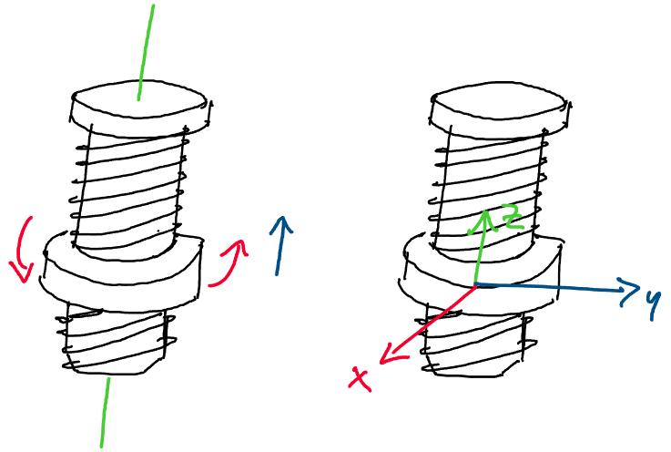
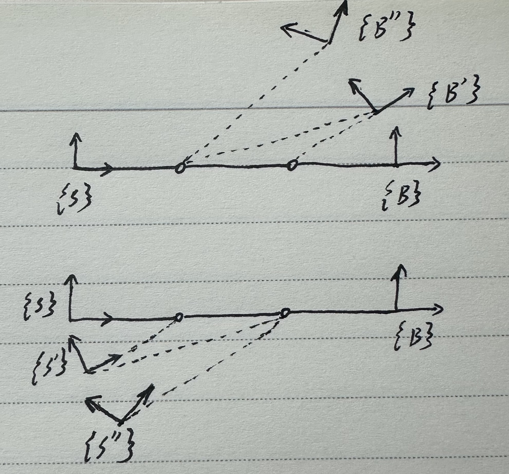
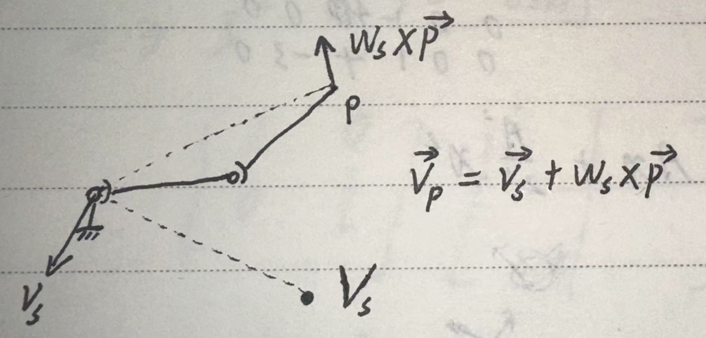

# 机器人学复习笔记：旋量理论与运动学、动力学基础

## 一、刚体运动与李群、李代数基础

### 1.1 Chasles 定理与刚体位移

根据刚体运动的几何性质，任何一个一般的三维刚体位移，都可以等效地表示为：**绕空间中某一条固定轴旋转，同时沿着这条轴平移**（Chasles 定理，亦称螺旋位移定理）。

### 1.2 反对称矩阵与 $\mathfrak{so}(3)$

给定三维向量 $x = \begin{bmatrix} x_1 & x_2 & x_3 \end{bmatrix}^{\mathrm{T}} \in \mathbb{R}^3$，定义其对应的 $3 \times 3$ 反对称矩阵（Skew-Symmetric Matrix）为：

$$[x] = \begin{bmatrix} 0 & -x_3 & x_2 \\ x_3 & 0 & -x_1 \\ -x_2 & x_1 & 0 \end{bmatrix}$$

反对称矩阵满足转置负对称性质：

$$[x] = -[x]^{\mathrm{T}}$$

所有 $3 \times 3$ 实反对称矩阵构成的集合称为特殊正交群 $\mathrm{SO}(3)$ 的李代数，记作 $\mathfrak{so}(3)$。对于任意 $x, y \in \mathbb{R}^3$，向量叉乘可表示为矩阵乘法：$[x]y = x \times y$。

### 1.3 特殊正交群 $\mathrm{SO}(3)$

$\mathrm{SO}(3)$ 是三维空间中所有合法旋转矩阵组成的特殊正交群（李群），用于描述刚体的姿态（Orientation）：

$$\mathrm{SO}(3) = \left\{ R \in \mathbb{R}^{3 \times 3} \;\middle\vert{}\; R^{\mathrm{T}}R = I,\; \det(R) = 1 \right\}$$

### 1.4 特殊欧几里得群 $\mathrm{SE}(3)$

$\mathrm{SE}(3)$ 是三维空间中所有刚体位姿变换矩阵（**齐次变换矩阵**）组成的特殊欧几里得群（李群），用于同时描述刚体的姿态与位置：

$$\mathrm{SE}(3) = \left\{ T = \begin{bmatrix} R & p \\ 0 & 1 \end{bmatrix} \;\middle\vert{}\; R \in \mathrm{SO}(3),\; p \in \mathbb{R}^3 \right\}$$

齐次变换矩阵的逆矩阵具有简洁的闭式形式：

$$\boxed{T^{-1} = \begin{bmatrix} R^{\mathrm{T}} & -R^{\mathrm{T}}p \\ 0 & 1 \end{bmatrix}}$$

一个 $T \in \mathrm{SE}(3)$ 对应刚体在空间中的一个位姿。

---

## 二、旋量（Twist）、指数映射与正运动学

### 2.1 旋量与 Twist 的向量及矩阵形式

刚体的瞬时运动可分解为角速度 $\omega \in \mathbb{R}^3$（旋转分量）与线速度 $v \in \mathbb{R}^3$（平移分量）。在机器人学中，常将两者组合成六维列向量表示瞬时运动（Twist）：

$$\boxed{V = \begin{bmatrix} \omega \\ v \end{bmatrix} \in \mathbb{R}^6}, \qquad \omega = \begin{bmatrix} \omega_x \\ \omega_y \\ \omega_z \end{bmatrix}, \quad v = \begin{bmatrix} v_x \\ v_y \\ v_z \end{bmatrix}$$

在螺旋轴/关节旋量表示中，也常记作螺旋轴（Screw Axis）向量 $\mathcal{S} = \begin{bmatrix} \omega \\ v \end{bmatrix}$：

* **转动关节**：$\omega$ 通常为单位旋转轴方向向量（$\Vert{}\omega\Vert{} = 1$），$v = -\omega \times q$（$q$ 为轴线上任意一点的位置向量，螺距 $h = 0$）。
* **移动关节**：$\omega = 0$，$v$ 通常为单位平移方向向量（$\Vert{}v\Vert{} = 1$，螺距 $h = \infty$）。

Twist $V$ 对应的 $4 \times 4$ 矩阵形式定义为：

$$\boxed{[V] = \begin{bmatrix} [\omega] & v \\ 0 & 0 \end{bmatrix} = \begin{bmatrix} 0 & -\omega_z & \omega_y & v_x \\ \omega_z & 0 & -\omega_x & v_y \\ -\omega_y & \omega_x & 0 & v_z \\ 0 & 0 & 0 & 0 \end{bmatrix} \in \mathfrak{se}(3)}$$

其中 $\mathfrak{se}(3)$ 是 $\mathrm{SE}(3)$ 的李代数。简而言之：**李群 $\mathrm{SE}(3)$ 描述刚体的有限位姿，李代数 $\mathfrak{se}(3)$ 描述刚体的瞬时运动（速度），两者通过矩阵指数建立联系**。

### 2.2 空间 Twist、本体 Twist 与伴随矩阵

设刚体随时间变化的位姿为 $T(t) = \begin{bmatrix} R(t) & p(t) \\ 0 & 1 \end{bmatrix}$：

* **空间坐标系下的 Twist**（固定空间坐标系 $\{s\}$ 中表达）：

$$\boxed{[V_s] = \dot{T}T^{-1}}$$

* **本体坐标系下的 Twist**（刚体自身坐标系 $\{b\}$ 中表达）：

$$\boxed{[V_b] = T^{-1}\dot{T}}$$

同一瞬时运动在不同参考坐标系下的 Twist 通过**伴随矩阵（Adjoint Matrix）** $\mathrm{Ad}_T \in \mathbb{R}^{6 \times 6}$ 转换。对 $T = \begin{bmatrix} R & p \\ 0 & 1 \end{bmatrix}$，伴随矩阵定义为：

$$\boxed{\mathrm{Ad}_T = \begin{bmatrix} R & 0 \\ [p]R & R \end{bmatrix}}$$

Twist 的坐标变换关系为：

$$\boxed{V_s = \mathrm{Ad}_{T_{sb}} V_b}, \qquad \boxed{V_b = \mathrm{Ad}_{T_{sb}^{-1}} V_s}$$

伴随矩阵满足群同态与求逆性质：

$$\mathrm{Ad}_{T_1 T_2} = \mathrm{Ad}_{T_1}\mathrm{Ad}_{T_2}, \qquad \mathrm{Ad}_{T^{-1}} = (\mathrm{Ad}_T)^{-1}$$

### 2.3 矩阵指数与指数映射

矩阵指数定义为幂级数展开：

$$e^A = I + A + \frac{A^2}{2!} + \frac{A^3}{3!} + \cdots$$

已知关节旋量 $\mathcal{S}$ 与关节变量 $\theta$，刚体经指数映射得到的位姿变换矩阵为：

$$\boxed{T = e^{[S]\theta}}$$

#### 1. $\mathrm{SO}(3)$ 的指数映射（Rodrigues 公式）

当 $\Vert{}\omega\Vert{} = 1$、旋转角为 $\theta$ 时，$R = e^{[\omega]\theta}$ 的闭式展开为：

$$\boxed{R = e^{[\omega]\theta} = I + \sin\theta\,[\omega] + (1 - \cos\theta)[\omega]^2}$$

#### 2. $\mathrm{SE}(3)$ 的指数映射

设 $S = \begin{bmatrix} \omega \\ v \end{bmatrix}$，对应 $[S] = \begin{bmatrix} [\omega] & v \\ 0 & 0 \end{bmatrix}$。当 $\Vert{}\omega\Vert{} = 1$ 时：

$$\boxed{e^{[S]\theta} = \begin{bmatrix} R & p(\theta) \\ 0 & 1 \end{bmatrix} = T(\theta)}$$

其中旋转部分 $R = e^{[\omega]\theta}$，平移部分为：

$$\boxed{p(\theta) = \left(I\theta + (1 - \cos\theta)[\omega] + (\theta - \sin\theta)[\omega]^2\right)v}$$

（若 $\omega = 0$ 且 $\Vert{}v\Vert{} = 1$，则为纯平移：$R = I$，$p(\theta) = v\theta$。）

### 2.4 指数积（POE）正运动学公式

#### 1. 空间形式 POE

设串联机械臂共有 $n$ 个关节，零位时各关节旋量在**同一空间坐标系**下表示为 $S_1, S_2, \cdots, S_n$，关节变量为 $\theta_1, \theta_2, \cdots, \theta_n$，零位时末端执行器相对空间坐标系的位姿为 $M \in \mathrm{SE}(3)$，则正运动学公式为：

$$\boxed{T(\theta) = e^{[S_1]\theta_1} e^{[S_2]\theta_2} \cdots e^{[S_n]\theta_n} M}$$

* **物理意义**：每个指数项 $e^{[S_i]\theta_i}$ 表示第 $i$ 个关节运动产生的刚体变换；按关节顺序从左到右连乘后右乘零位位姿 $M$，即得当前末端位姿。所有 $S_i$ 必须在零位下于同一空间坐标系中定义。

#### 2. 本体形式 POE

若零位时第 $i$ 个关节旋量在**末端执行器（本体）坐标系**下的表达为 $B_i$，则本体形式 POE 为：

$$\boxed{T(\theta) = M e^{[B_1]\theta_1} e^{[B_2]\theta_2} \cdots e^{[B_n]\theta_n}}$$

#### 3. 空间 POE 与本体 POE 的对比

| 对比维度 | 空间 POE | 本体 POE |
| --- | --- | --- |
| 旋量表达坐标系 | 空间坐标系（零位） | 末端/本体坐标系（零位） |
| 零位变换 $M$ 位置 | 放在右侧 | 放在左侧 |
| 关节旋量符号 | $S_i$ | $B_i$ |
| 公式结构 | 指数积右乘 $M$ | $M$ 左乘指数积 |

两种形式在数学上等价，对同一构型与关节角计算出的末端位姿 $T(\theta)$ 完全相同。

#### 4. POE 与 D-H 方法的对比

| 对比维度 | D-H 参数法 | 旋量 POE 方法 |
| --- | --- | --- |
| 建模基础 | 连杆坐标系 | 关节运动轴（旋量）与零位位姿 |
| 核心参数 | 连杆长度、扭角、连杆偏置、关节角 | 关节旋量 $S_i$（或 $B_i$）与零位 $M$ |
| 坐标系要求 | 需严格遵循连杆坐标系建立规则 | 仅需基座与末端坐标系，建模更灵活 |
| 正运动学 | 齐次变换矩阵连乘 | 指数矩阵连乘 |
| 雅可比推导 | 常用几何雅可比或微分变换 | 可直接由旋量与伴随变换系统推导 |

POE 与 D-H 均正确且各有适用场景；POE 在统一表达转动/移动关节及推导速度雅可比时尤为简洁。

---

## 三、机器人雅可比矩阵与奇异性

### 3.1 雅可比矩阵的作用

正运动学 $T = f(\theta)$ 描述关节位置与末端位姿的映射；**雅可比矩阵**则描述关节速度 $\dot{\theta} \in \mathbb{R}^n$ 与末端瞬时 Twist $V \in \mathbb{R}^6$ 之间的线性映射：

$$\boxed{V = J(\theta)\dot{\theta}}, \qquad J(\theta) \in \mathbb{R}^{6 \times n}, \quad \dot{\theta} = \begin{bmatrix} \dot{\theta}_1 \\ \dot{\theta}_2 \\ \vdots \\ \dot{\theta}_n \end{bmatrix}$$

### 3.2 空间雅可比矩阵 $J_s(\theta)$

由空间 POE 公式 $T = e^{[S_1]\theta_1}\cdots e^{[S_n]\theta_n}M$ 出发，空间 Twist $V_s = J_s(\theta)\dot{\theta}$ 的第 $i$ 列为：

$$\boxed{J_s = \begin{bmatrix} J_{s1} & J_{s2} & \cdots & J_{sn} \end{bmatrix}}$$

$$\boxed{J_{si} = \mathrm{Ad}_{e^{[S_1]\theta_1}\cdots e^{[S_{i-1}]\theta_{i-1}}} S_i} \quad (\text{其中 } J_{s1} = S_1)$$

第 $i$ 列表示第 $i$ 个关节旋量在当前构型下变换到空间坐标系中的瞬时运动。

### 3.3 本体雅可比矩阵 $J_b(\theta)$

由本体 POE 公式 $T = Me^{[B_1]\theta_1}\cdots e^{[B_n]\theta_n}$ 出发，本体 Twist $V_b = J_b(\theta)\dot{\theta}$ 的第 $i$ 列为：

$$J_b = \begin{bmatrix} J_{b1} & J_{b2} & \cdots & J_{bn} \end{bmatrix}$$

$$\boxed{J_{bi} = \mathrm{Ad}_{e^{-[B_n]\theta_n} \cdots e^{-[B_{i+1}]\theta_{i+1}}}B_i} \quad (\text{其中 } J_{bn} = B_n)$$

### 3.4 几何雅可比矩阵 $J_g(\theta)$

几何雅可比矩阵（Geometric Jacobian），也常称为笛卡尔速度雅可比矩阵（Cartesian Velocity Jacobian）。空间雅可比矩阵映射后得到的是空间运动旋量，不是末端坐标系的实际速度，**实际速度可由几何雅可比映射得到**。

$$\boxed{J_g = \begin{bmatrix}\omega_g \\ v_g \end{bmatrix}}$$

### 3.5 空间雅可比、本体雅可比、几何雅可比的关系

#### 3.5.1 空间雅可比、本体雅可比的关系

结合 $V_s = \mathrm{Ad}_{T_{sb}} V_b$ 与 $V_b = \mathrm{Ad}_{T_{sb}^{-1}} V_s$，可得：

$$\boxed{J_b = \mathrm{Ad}_{T_{sb}^{-1}} J_s}, \qquad \boxed{J_s = \mathrm{Ad}_{T_{sb}} J_b}$$

#### 3.5.2 空间雅可比、几何雅可比的关系

由于空间旋量的线速度 $v_s$ 是空间坐标系原点的速度，而几何雅可比需要的是物体坐标系原点（即位置 $p$）的速度。根据刚体运动学，$p$ 点的速度等于空间原点的速度加上旋转引起的牵连速度，即 $v_s + \omega_s \times p$。

$$\boxed{J_g = \begin{bmatrix}\omega_g \\ v_g \end{bmatrix} = \begin{bmatrix}\omega_s \\ \omega_s \times p + v_s \end{bmatrix} = \begin{bmatrix}\omega_s \\ v_s - [p]\omega_s  \end{bmatrix}}$$

写成矩阵形式：

$$\boxed{J_g = \begin{bmatrix} \bm{I} & \bm{0} \\ -[\bm{p}] & \bm{I} \end{bmatrix} J_s} , \qquad \boxed{J_s = \begin{bmatrix} \bm{I} & \bm{0} \\ [\bm{p}] & \bm{I} \end{bmatrix} J_g}$$

#### 3.5.3 本体雅可比、几何雅可比的关系
由上述本体雅可比与空间雅可比的关系、空间雅可比与几何雅可比的关系，可得：

$$\boxed{J_g = \begin{bmatrix} \bm{R_{sb}} & \bm{0} \\ \bm{0} & \bm{R_{sb}} \end{bmatrix} J_b} , \qquad \boxed{J_b = \begin{bmatrix} \bm{R_{sb}^{T}} & \bm{0} \\ \bm{0} & \bm{R_{sb}^{T}} \end{bmatrix} J_g}$$

#### 3.5.4 空间雅可比、本体雅可比、几何雅可比的关系

### 3.6 运动学奇异性

当雅可比矩阵发生降秩时：

$$\boxed{\operatorname{rank}(J) < \min(6, n)}$$

机械臂处于**奇异构型（Singularity）**。此时：

* 末端在某些方向上失去瞬时运动能力（无法实现该方向的 Twist）；
* 若强行要求沿受限方向运动，可能需要极高的关节速度；
* **旋量几何解释**：雅可比矩阵各列是各关节旋量在相应坐标系下的表达，奇异性对应这些旋量列向量之间出现线性相关。

---

## 四、逆运动学数值解法

### 4.1 逆运动学问题与对数映射

给定末端目标位姿 $T_d \in \mathrm{SE}(3)$，求解关节角向量 $\theta$ 使得 $T(\theta) = T_d$。矩阵指数的逆运算为**矩阵对数（Logarithm Mapping）**：

$$\boxed{[S]\theta = \log(T)}$$

通过 $\operatorname{se3ToVec}(\cdot)$ 可将 $\mathfrak{se}(3)$ 矩阵提取为六维 Twist 向量。由于旋转角具有 $2\pi$ 周期性，对数映射通常并非全局唯一。

### 4.2 基于本体雅可比的牛顿-拉夫逊迭代

1. 计算当前位姿 $T(\theta)$ 与目标位姿 $T_d$ 在本体坐标系下的误差变换：

$$\boxed{T_{\text{err}} = T(\theta)^{-1}T_d}$$

2. 计算误差对应的本体 Twist：

$$\boxed{V_b^{\text{err}} = \operatorname{se3ToVec}\left(\log(T_{\text{err}})\right)}$$

3. 利用 $V_b \approx J_b\Delta\theta$, ($\dot{\theta} \approx \frac{\Delta\theta}{\Delta t}$)求解关节增量并更新：

$$\boxed{\Delta\theta = J_b^{+} V_b^{\text{err}}}, \qquad \boxed{\theta_{k+1} = \theta_k + \Delta\theta}$$

其中 $J_b^{+}$ 为 $J_b$ 的 Moore-Penrose 伪逆。迭代直至 $\Vert{}V_b^{\text{err}}\Vert{}$ 小于设定阈值。该方法基于局部线性化，收敛性依赖初值选择。

### 4.3 基于空间雅可比的牛顿-拉夫逊迭代

1. 计算当前位姿 $T(\theta)$ 与目标位姿 $T_d$ 在空间坐标系下的误差变换：

$$\boxed{T_{\text{err}} = T_d T(\theta)^{-1}}$$

2. 计算误差对应的空间 Twist：

$$\boxed{V_s^{\text{err}} = \operatorname{se3ToVec}\left(\log(T_{\text{err}})\right)}$$

3. 利用 $V_s \approx J_s\Delta\theta$ 求解关节增量并更新：

$$\boxed{\Delta\theta = J_s^{+} V_s^{\text{err}}}, \qquad \boxed{\theta_{k+1} = \theta_k + \Delta\theta}$$

其中 $J_s^{+}$ 为 $J_s$ 的 Moore-Penrose 伪逆。迭代直至 $\Vert{}V_s^{\text{err}}\Vert{}$ 小于设定阈值。该方法基于局部线性化，收敛性依赖初值选择。

### 4.4 阻尼最小二乘法（Levenberg-Marquardt 思想）

在奇异构型附近，伪逆 $J_b^{+}$ 可能导致 $\Delta\theta$ 过大。引入阻尼系数 $\lambda > 0$ 的阻尼最小二乘法可提升数值稳定性：

$$\boxed{\Delta\theta = J_b^{\mathrm{T}}(J_b J_b^{\mathrm{T}} + \lambda^2 I)^{-1} V_b^{\text{err}}}$$

### 4.5 增加步长系数
增加一个步长系数 $\alpha$：
$$\boxed{\theta_{k+1}=\theta_k+\alpha\Delta\theta}$$

其中：$0<\alpha\leq1$每次只执行计算得到的关节增量的一半。这有助于改善某些情况下的迭代稳定性，但不保证所有情况下都能收敛。

### 4.6 迭代终止条件
Twist 的前三维是旋转误差，单位为 rad；后三维是平移误差，单位为 m。直接计算六维向量的欧氏范数，会将两种不同物理量混合。
推荐分别判断：
$$\boxed{\|\phi\|<\varepsilon_\omega}$$
$$\boxed{\|\rho\|<\varepsilon_v}$$
这里：
- $\varepsilon_\omega$：旋转误差阈值。
- $\varepsilon_v$：平移误差阈值。

---

## 五、静力学与动力学中的旋量表示

### 5.1 力旋量（Wrench）与功率

将作用在刚体上的力矩 $m \in \mathbb{R}^3$ 与力 $f \in \mathbb{R}^3$ 组合成六维向量，称为 **Wrench（力旋量）**（同样采用前三维力矩、后三维力的排列顺序）：

$$\boxed{F = \begin{bmatrix} m \\ f \end{bmatrix}}$$

例如 $F = \begin{bmatrix} 0 & 0 & 5 & 10 & 0 & 0 \end{bmatrix}^{\mathrm{T}}$ 表示绕 $z$ 轴 $5\text{ N}\cdot\text{m}$ 的力矩与沿 $x$ 轴 $10\text{ N}$ 的力。

Wrench 与 Twist 的内积为瞬时功率 $P$：

$$\boxed{P = F^{\mathrm{T}}V = m^{\mathrm{T}}\omega + f^{\mathrm{T}}v}$$

### 5.2 力旋量的坐标变换

由 $V_s = \mathrm{Ad}_{T_{sb}} V_b$ 及功率不变性 $F_s^{\mathrm{T}}V_s = F_b^{\mathrm{T}}V_b$，可得 Wrench 的坐标变换公式：

$$\boxed{F_b = \mathrm{Ad}_{T_{sb}}^{\mathrm{T}} F_s}, \qquad \boxed{F_s = \mathrm{Ad}_{T_{sb}}^{-\mathrm{T}} F_b}$$

注意：Twist 与 Wrench 的坐标变换矩阵不同，不可混淆。

### 5.3 关节力矩与末端力旋量的映射

由虚功原理 $F^{\mathrm{T}}V = \tau^{\mathrm{T}}\dot{\theta}$ 及 $V = J\dot{\theta}$，可得关节力矩向量 $\tau$ 与末端 Wrench $F$ 的关系：

$$\boxed{\tau = J^{\mathrm{T}}F}$$

（注意：$J$ 与 $F$ 必须表达在同一参考坐标系下，如均在空间系 $J_s, F_s$ 或均在本体系 $J_b, F_b$。）该关系广泛用于末端受力分析、重力补偿、力控与阻抗控制。

### 5.4 空间惯性矩阵与刚体动力学

在六维旋量框架下，刚体的空间惯性矩阵 $\mathcal{G} \in \mathbb{R}^{6 \times 6}$ 定义为：

$$\mathcal{G} = \begin{bmatrix} I - m[c][c] & m[c] \\ -m[c] & mI_3 \end{bmatrix}$$

其中 $m$ 为刚体质量，$c \in \mathbb{R}^3$ 为质心相对刚体坐标系原点的位置，$I$ 为刚体关于质心的转动惯量矩阵，$I_3$ 为 $3 \times 3$ 单位阵。

刚体的**空间动量（Spatial Momentum）** $\mathcal{P} \in \mathbb{R}^6$ 为：

$$\boxed{\mathcal{P} = \mathcal{G}V}$$

进一步地，在无外力或外力旋量为 $\mathcal{F}$ 的情况下，刚体运动方程可写为 $\mathcal{F} = \dot{\mathcal{P}} - \mathrm{ad}_V^{\mathrm{T}}\mathcal{P} = \mathcal{G}\dot{V} - \mathrm{ad}_V^{\mathrm{T}}\mathcal{G}V$（其中 $\mathrm{ad}_V$ 为 $[V]$ 的伴随算子，在 $\mathrm{SE}(3)$ 中满足 $\mathrm{ad}_{V_1}V_2 = [V_1]V_2 - [V_2]V_1$ 的向量形式），从而将多刚体牛顿-欧拉动力学统一纳入旋量代数体系。

---

